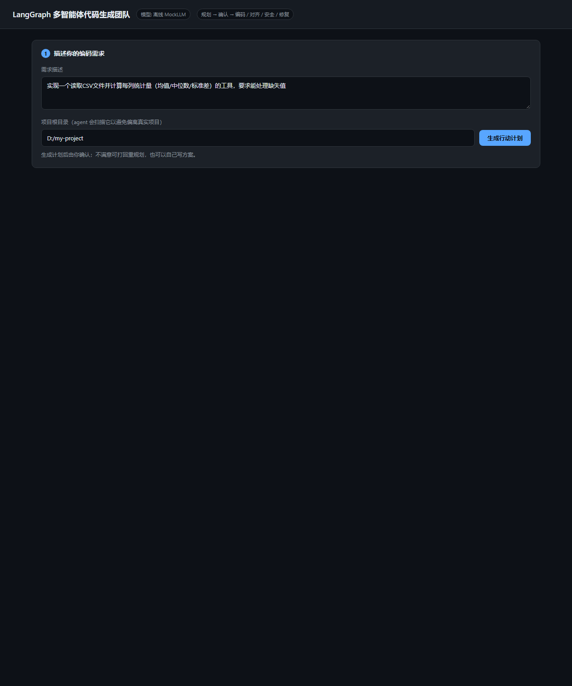
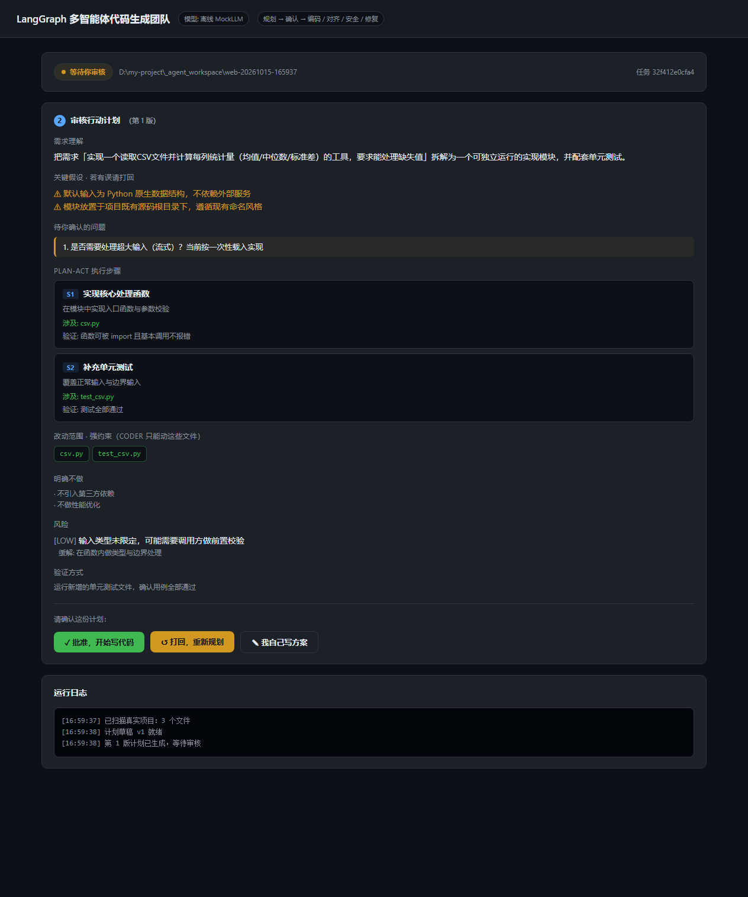
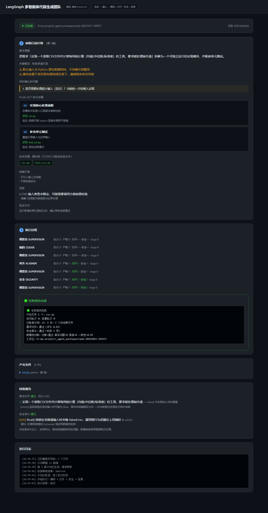

# Multi-Agent for Planning · Coding · Test · Security

> 一个基于 **LangGraph** 的多智能体代码生成团队：先规划、人工确认，再分工编码，自动做需求对齐与安全审计，循环修复直到通过或熔断。

[](https://www.python.org/)
[](https://github.com/langchain-ai/langgraph)
[](./LICENSE)

---

## 目录

- [一、这是什么](#一这是什么)
- [二、它解决什么问题](#二它解决什么问题)
- [三、架构设计](#三架构设计)
- [四、快速开始](#四快速开始)
- [五、三种运行方式](#五三种运行方式)
- [六、配置说明](#六配置说明)
- [七、代码结构](#七代码结构)
- [八、可调参数](#八可调参数)
- [九、运行自检](#九运行自检)
- [十、已知限制](#十已知限制)
- [十一、开源声明](#十一开源声明)

---

## 一、这是什么

给一句话需求，它替你走完「想清楚 → 写代码 → 自己检查」的全过程。但和常见的"AI 一把梭"不同，它有两个刻意的设计：

**1. 不直接开写，先出计划给你确认**

```
用户提出需求
     │
     ▼
┌──────────────────────────────────────────┐
│ 阶段一：计划审核（可反复迭代）              │
│                                          │
│  PLANNER 产出 Plan-Act 草稿：             │
│    · 需求理解   · 隐含假设                 │
│    · 待确认问题  · 执行步骤                │
│    · 改动范围白名单 · 风险 · 验证方式        │
│         │                                │
│         ▼                                │
│  你来审核 —— 三个选择：                     │
│    ① 批准            → 进入阶段二           │
│    ② 打回并说明理由    → 重新规划            │
│    ③ 自己写方案        → 框架据此重组计划     │
│  （循环直到批准，或达到重规划上限）           │
└──────────────────────────────────────────┘
     │ 已批准的计划（作为强约束）
     ▼
┌──────────────────────────────────────────┐
│ 阶段二：自动执行                           │
│  CODER → ALIGNER → SECURITY → BUGFIXER   │
└──────────────────────────────────────────┘
```

**2. 每个环节都有"事实"约束，不靠提示词反复叮嘱**

开工前扫描真实项目，产出一份客观快照（文件树、依赖、既有测试、目录约定），所有智能体动手前都必须读同一份快照。把"要贴紧项目"从一句叮嘱，变成必然读到的输入。

### 界面预览

**① 输入需求**（指定要操作的真实项目目录）



**② 审核行动计划**（这是最值得停下来看的一步）

每个步骤都标明：涉及哪些文件、怎么验证。左侧"改动范围"是硬约束，右边的"待确认问题"列出了模型替你做的假设。



**③ 执行过程与结果**

调度官的每一次路由、对齐与安全审计的结论、产出文件、校验报告，全部留痕。



---

## 二、它解决什么问题

多智能体最危险的不是能力不足，而是**幻觉式漂移**——凭想象写出项目里不存在的模块、引入没装的依赖、违反既有目录结构。而一旦各智能体之间信息不同步，还会出现"你以为我改了、我以为你改了"的错位。

本项目用五个结构性机制来压制它：

| 机制 | 做法 |
| --- | --- |
| **防跑偏快照** | 扫描真实项目生成 `project_snapshot.json`，所有智能体动手前必读 |
| **按需阅读** | CODER 可主动请求读取真实文件，而不是全量塞进上下文（含围栏、拦截、脱敏边界） |
| **计划强约束** | 计划里的"改动范围白名单"是硬约束，越界写入会被拦截 |
| **模块拆分 + 跨模块对账** | 文件较多时按模块分段生成，再统一对账，避免模块间接口不一致 |
| **共享工作区（黑板）** | 所有消息、报告、产物落盘，全程可回看、可复现 |

---

## 三、架构设计

### 3.1 图结构

基于 LangGraph 的中心化编排：所有节点执行完都回到 `supervisor`，由它决定下一步去哪。

```
                    ┌──────────────┐
        START ─────►│  supervisor  │◄──────────────┐
                    │  （调度官）    │               │
                    └──────┬───────┘               │
                           │ 依据状态决定路由         │
        ┌──────────┬───────┼───────┬──────────┐    │
        ▼          ▼       ▼       ▼          ▼    │
   ┌────────┐ ┌────────┐ ┌───────┐ ┌────────┐ ┌─────────┐
   │planner │ │ coder  │ │aligner│ │security│ │bugfixer │
   │ 规划   │ │ 编码   │ │需求对齐│ │ 安全审计│ │ 缺陷修复 │
   └───┬────┘ └───┬────┘ └───┬───┘ └───┬────┘ └────┬────┘
       │          │          │         │           │
       └──────────┴──────────┴─────────┴───────────┘
                           │
                           ▼
                      ┌────────┐
                      │ repair │  修复后复检
                      └───┬────┘
                          └──────────────► 回到 supervisor
```

调度官可路由到的目标及其含义：

| 路由 | 含义 |
| --- | --- |
| `planner` | 制定/重规划行动计划 |
| `coder` | 编码 |
| `aligner` | 需求对齐检查 |
| `security` | 安全审计 |
| `bugfixer` | 缺陷修复 |
| `repair` | 修复后复检 |
| `done` | 任务完成 |
| `abort` | 中止（触发熔断，交还人类） |

路由由**确定性规则**决定（读取共享状态判断），而不是让模型自由发挥——这样行为可预测、可测试。

### 3.2 智能体分工

| 智能体 | 职责 |
| --- | --- |
| **Supervisor** | 中心调度，读取共享状态决定下一个执行者；负责熔断判断 |
| **Planner** | 生成 Plan-Act：需求理解、假设、待确认问题、步骤、改动白名单、风险 |
| **Coder** | 按已批准计划编码，可主动请求读取真实项目文件 |
| **Aligner** | 检查产出是否真正满足需求，给出对齐评分 |
| **Security** | 安全审计，识别注入、危险调用、敏感信息泄漏等问题 |
| **Bugfixer** | 依据对齐/安全报告修复缺陷 |
| **Repair** | 修复后的复检，确认问题真的解决了 |

### 3.3 为什么要"待确认问题"

如果计划只是把需求复述一遍，审核就成了走过场。真正值得人看的是模型**没把握的地方**——它会怎么理解、替你做了哪些决定、有哪些歧义。

实测中，规划官对一个"手机号校验"需求主动提出了 5 个待确认问题（是否支持 `+86` 前缀、号段校验严格程度、函数放在哪、命名、返回值形式）。这些恰恰是返工的高发点。

### 3.4 熔断保护

多智能体互推容易陷入死循环，因此有多重上限：

- `CODER_MAX_ITER` —— 整体迭代轮次上限
- `CODER_MAX_BUGFIX` —— 缺陷修复轮次上限
- `CODER_MAX_PLAN` —— 计划重规划轮次上限（防止用户与 planner 反复拉扯）
- `CODER_MAX_CODE_TRIES` —— 编码连续无产出上限（兜底"一直交白卷"）

任一路径触顶即路由到 `abort`，把控制权交还给人，而不是无限重试烧 token。

---

## 四、快速开始

### 4.1 环境要求

- **Python 3.10+**
- 一个 OpenAI 兼容的大模型端点（OpenAI / DeepSeek / 通义千问 / 本地 vLLM 均可）
- 无需 API Key 也能试跑（见下方 Mock 模式）

### 4.2 安装

```bash
# 1) 克隆项目
git clone https://github.com/PassionCR7/multi-agent-codegen-team.git
cd multi-agent-codegen-team

# 2) 创建虚拟环境
python -m venv .venv

# Windows
.venv\Scripts\activate
# macOS / Linux
source .venv/bin/activate

# 3) 安装依赖
pip install -r requirements.txt

# 4) 准备配置
cp .env.example .env
# 然后用编辑器打开 .env，填入你的密钥与端点
```

### 4.3 配置密钥

打开 `.env`，填入你的信息：

```ini
# 此处填写你的大模型 API 账户密钥
OPENAI_API_KEY=sk-your-api-key-here

# 此处填写你的大模型服务地址
# DeepSeek:  https://api.deepseek.com/v1
# OpenAI:    https://api.openai.com/v1
# 本地 vLLM: http://127.0.0.1:8000/v1
OPENAI_BASE_URL=https://api.deepseek.com/v1

# 使用的模型名
CODER_MODEL=deepseek-chat
```

> ⚠️ **请勿把填好真实密钥的 `.env` 提交到 Git**。`.gitignore` 已默认排除它。

---

## 五、三种运行方式

### 方式一：Web 界面（推荐先试这个）

图形化审核计划，最直观。

```bash
python web/server.py                # 默认 http://127.0.0.1:8765
python web/server.py --port 9000    # 换端口
```

浏览器打开后：输入需求 → 查看计划 → 批准 / 打回 / 自拟 → 观看执行过程。

**支持的接口**：

| 方法 | 路径 | 说明 |
| --- | --- | --- |
| `POST` | `/api/tasks` | 创建任务（后台开始规划） |
| `GET` | `/api/tasks/<id>` | 查询任务快照（前端轮询） |
| `POST` | `/api/tasks/<id>/review` | 提交审核决策 |
| `GET` | `/api/tasks/<id>/messages` | 读取黑板消息流 |

刷新页面不会丢进度：`http://127.0.0.1:8765/?task=<id>` 可直接打开指定任务。

### 方式二：命令行交互式

同样支持计划审核，会在终端问你。

```bash
python -m agents.main "你的需求" --project .
```

会弹出选择：

```
1) 批准    2) 打回重规划    3) 我自己写方案
```

### 方式三：全自动（CI / 脚本）

```bash
# 自动批准首版计划，一条命令跑完
python -m agents.main "你的需求" --project . --auto-plan

# 只出计划不执行（把计划交给别人评审）
python -m agents.main "重构日志模块" --project . --plan-only
```

### 常用参数

| 参数 | 作用 |
| --- | --- |
| `--project <路径>` | 真实项目根目录（智能体会扫描它以免跑偏），默认当前目录 |
| `--task-name <名字>` | 指定工作区子目录名，便于回看 |
| `--workspace <目录>` | 复用已有工作区（配合 `--yes` 直接执行） |
| `--workspace-root <目录>` | 工作区的上级目录 |
| `--yes` | 跳过人工审核，自动批准计划 |
| `--auto-plan` | 自动批准首版计划（适合 CI） |
| `--plan-only` | 只生成并确认计划，不执行编码 |
| `--quiet` | 自动模式下不打印完整计划 |
| `--json` | 以 JSON 输出最终结果摘要（便于脚本解析） |
| `--graph` | 打印图结构（mermaid）后退出 |
| `--inspect <工作区>` | 查看某次任务的状态与已批准计划 |

### 离线试跑（不需要任何密钥）

想先看看它长什么样？用 Mock 模式即可跑通全流程：

```bash
CODER_MOCK=1 python -m agents.main "实现加法和减法" --project . --auto-plan
```

---

## 六、配置说明

全部配置通过 `.env` 或环境变量提供。完整字段见 [`.env.example`](./.env.example)。

### LLM 相关

| 变量 | 说明 | 示例 |
| --- | --- | --- |
| `OPENAI_API_KEY` | 你的大模型 API 密钥 | `sk-...` |
| `OPENAI_BASE_URL` | 服务端点地址 | `https://api.deepseek.com/v1` |
| `CODER_MODEL` | 模型名 | `deepseek-chat` |
| `CODER_TEMPERATURE` | 采样温度 | `0.2` |
| `CODER_TIMEOUT` | 单次请求超时（秒） | `180` |
| `CODER_MOCK` | 置 `1` 强制离线 Mock 模式 | 空 / `1` |

### 工作区

| 变量 | 说明 | 默认 |
| --- | --- | --- |
| `CODER_WORKSPACE` | 任务产物存放目录 | `_agent_workspace` |

---

## 七、代码结构

```
Multi-Agent_for_Planning-Coding-Test-Security/
├── run.py                    便捷入口（等价于 python -m agents.main）
├── requirements.txt
├── .env.example              配置模板（复制为 .env 后填写）
├── .gitignore
├── LICENSE
├── README.md                 本文件：概览、架构、使用
├── DESIGN.md                 内部设计详解（数据层 / 路由决策表 / 已知局限）
├── RUNNING.md                运行方式与踩坑排查
│
├── agents/                   核心实现
│   ├── main.py               CLI 入口与参数解析（含交互式计划审核）
│   ├── graph.py              LangGraph 图定义与组装
│   ├── supervisor.py         调度官：确定性路由规则与计划闸门
│   ├── nodes.py              各智能体节点实现（planner + 业务 agent + repair）
│   ├── plan.py               Plan 数据模型与范围校验（强约束的执法点）
│   ├── review.py             计划审核循环（可插拔 reviewer）
│   ├── prompts.py            各角色提示词（含机器可读角色标记）
│   ├── scanner.py            真实项目扫描 → project_snapshot.json
│   ├── reader.py             安全文件读取器（按需阅读的边界：围栏/拦截/脱敏）
│   ├── runner.py             执行阶段运行器（流式执行）
│   ├── workspace.py          共享工作区（黑板）读写
│   ├── state.py              共享状态与 reducer
│   ├── interface.py          跨模块接口提取与一致性分析
│   ├── config.py             配置与 LLM 工厂（真实 / Mock 自动降级）
│   └── utils.py              通用工具
│
├── web/                      Web 界面
│   ├── server.py             零依赖 HTTP 服务 + REST API（stdlib http.server）
│   ├── static/index.html     单文件前端（无构建步骤）
│   └── preview/              界面截图
│
└── tests/                    自检脚本
    ├── selftest.py                 执行阶段自检（58 项：含按需阅读与熔断）
    ├── selftest_plan.py            计划阶段自检（33 项）
    ├── selftest_multimodule.py     模块拆分、对账与共享状态文档自检（52 项）
    └── test_web_api.py             Web API 端到端测试（24 项，需先启动服务）
```

### 任务工作区结构

每次任务会在 `_agent_workspace/<任务名>/` 下落盘全过程：

```
_agent_workspace/<任务名>/
├── task.md                   任务说明
├── project_snapshot.json     开工前的项目快照
├── messages.jsonl            黑板消息流（全部智能体往来）
├── runs.jsonl                各节点执行记录
├── artifacts/                产出的代码文件
├── reports/                  报告（见下）
└── status.json               当前状态快照（前端轮询用）
```

`reports/` 下保留完整痕迹，便于回溯"为什么最终是这个计划"：

```
reports/
├── plan_v1.json / plan_v1.md             每版计划（草稿）
├── plan_v1_rejected.json                 被打回的版本（含用户理由）
├── plan_v2.json / plan_v2.md
├── plan_v2_approved.json                 获批的版本
├── plan_approved.json / plan_approved.md 固定文件名，供 --workspace --yes 复用
├── alignment_iter1.json                  需求对齐报告
├── security_iter1.json                   安全审计报告
└── final_state.json                      最终状态汇总
```

---

## 八、可调参数

除 LLM 配置外，以下参数用于控制行为边界：

| 变量 | 说明 | 默认 |
| --- | --- | --- |
| `CODER_MAX_ITER` | 整体迭代轮次上限，超出即熔断 | `6` |
| `CODER_MAX_BUGFIX` | 缺陷修复轮次上限，防止修不动的死循环 | `4` |
| `CODER_MAX_PLAN` | 计划重规划轮次上限，防止用户与 planner 反复拉扯 | `5` |
| `CODER_MAX_CODE_TRIES` | 编码连续无产出的上限（交白卷兜底） | `3` |
| `CODER_MAX_READ` | 按需阅读追问轮次上限 | `3` |
| `CODER_READ_FILES` | 每轮最多读取文件数 | `6` |
| `CODER_READ_BYTES` | 单文件体积上限（超出截断） | `60000` |
| `CODER_READ_LINES` | 单文件行数上限 | `900` |
| `CODER_SUBTASK_THRESHOLD` | 计划文件数达到该值才启用"分段生成 + 对账" | `2` |
| `CODER_SUBTASK_MAX` | 单任务最多处理的模块数 | `8` |
| `CODER_RECONCILE_ROUNDS` | 对账后最多允许的修补轮次 | `1` |

---

## 九、运行自检

项目自带多组自检脚本（合计 160+ 项断言），改代码后建议全跑一遍：

```bash
python -m tests.selftest              # 执行阶段（58 项）
python -m tests.selftest_plan         # 计划解析与路由约束（33 项）
python -m tests.selftest_multimodule  # 模块拆分与对账（52 项）

# Web API 测试需先启动服务
python web/server.py
python tests/test_web_api.py --base http://127.0.0.1:8765
```

---

## 十、已知限制

- **产出需要人复核**：它是个加速器的角色，不是"一键代替工程师"。生成的代码请在合并前 review。
- **安全审计不是万能的**：`security` 节点做的是启发式检查，不能替代专业的安全测试与渗透测试。
- **依赖真实项目的结构**：项目越规范（有清晰的目录、依赖清单、测试），防跑偏效果越好。
- **大项目扫描有截断**：单文件读取有字节/行数上限，超大文件会被截断，可能影响理解完整性。
- **Mock 模式仅用于跑通流程**：它产出的是桩代码，不要用于真实业务。
- **模型质量决定上限**：本框架压制的是"跑偏"，不能弥补模型本身的能力边界。

---

## 十一、开源声明

### 许可证

本项目基于 [MIT License](./LICENSE) 开源。

你可以自由地使用、修改、分发，甚至用于商业用途，只需保留版权声明即可。

### 贡献

欢迎提交 Issue 与 Pull Request。提交前建议：

1. 跑通 `tests/` 下全部自检
2. 不要提交 `.env` 或任何真实密钥
3. 遵循既有的代码风格与目录约定

### 安全提醒

- 本项目会读取你指定的项目目录，并可能在其中写入文件。**请先在测试目录上试用**，确认行为符合预期再用于重要项目。
- API Key 请通过 `.env` 提供，切勿硬编码进源码或提交到仓库。
- 若使用云端模型，请注意你的代码内容会发送到对应服务商。涉及敏感代码时，建议改用本地部署的模型端点。

### 致谢

基于 [LangGraph](https://github.com/langchain-ai/langgraph) 构建。

---

<p align="center">如果这个项目对你有帮助，欢迎点个 Star ⭐</p>